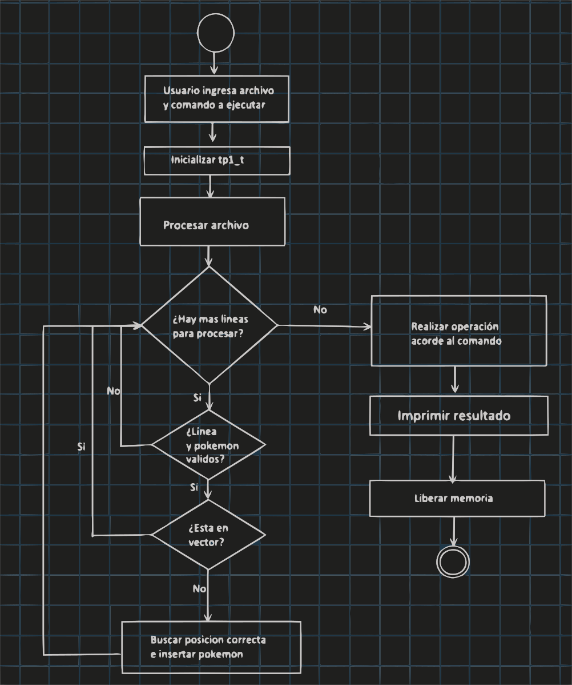
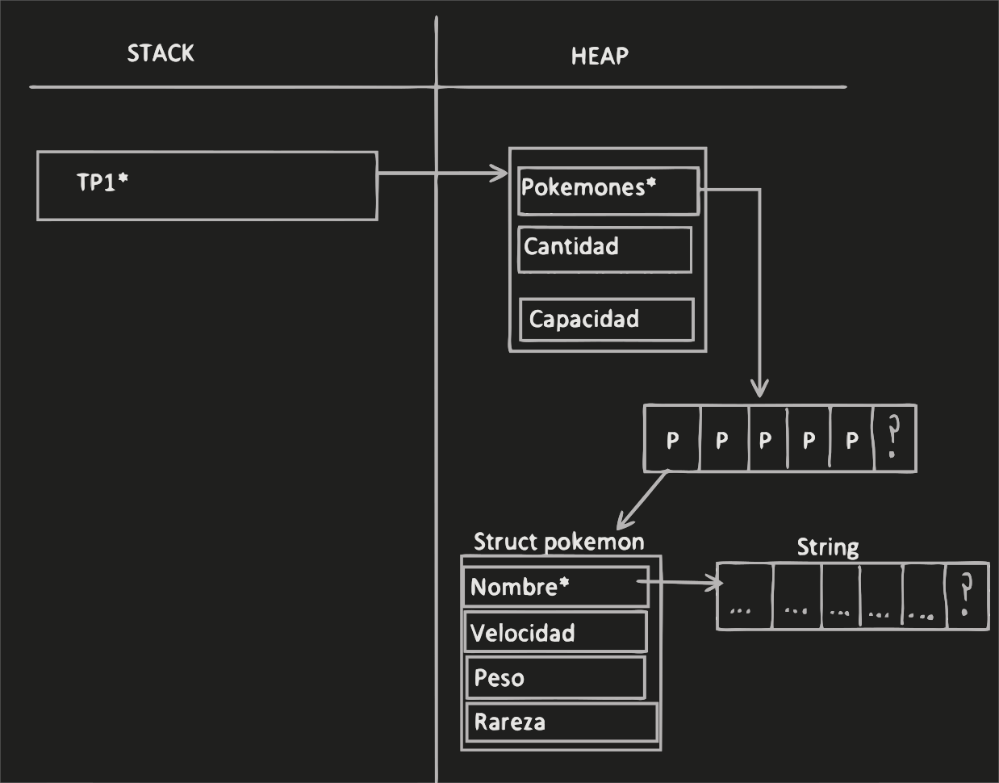

<div align="right">
    
</div>

# TP

## Información del estudiante

* Nicolas Martinez
* 115882
* nicolasmartinezalfonso@gmail.com
* Nicomartinez07

---

## Índice
* [1. Instrucciones](#1-Instrucciones)
  * [1.1. Compilar el proyecto](#11-Compilar-el-proyecto)
  * [1.2. Ejecutar las pruebas](#12-Ejecutar-las-pruebas)
  * [1.3. Ejecutar el programa con Valgrind](#13-Ejecutar-el-programa-con-Valgrind)
* [2. Funcionamiento](#2-Funcionamiento)
* [3. Estructura](#3-Estructura)
  * [3.1. Diagrama de memoria](#31-Diagrama-de-memoria)
  * [3.2. Análisis de complejidades](#32-Análisis-de-complejidades)
* [4. Decisiones de diseño y/o complejidades de implementación](#4-Decisiones-de-diseño-yo-complejidades-de-implementación)
* [5. Respuestas a las preguntas teóricas](#5-Respuestas-a-las-preguntas-teóricas)

## 1. Instrucciones

### 1.1. Compilar el proyecto
```bash
make compilar_programa_y_pruebas_alumno
```

### 1.2. Ejecutar las pruebas
```bash
make pruebas
```

### 1.3. Ejecutar el programa con Valgrind
```bash
make valgrind_alumno
```

## 2. Funcionamiento 
El programa es ejecutado por el usuario, con un correspondiente archivo y un respectivo comando. Dependiendo del comando ejecutado se realizan operaciones diferentes. Pero hay un proceso compartido por todos, el mismo es el proceso de leer un archivo y guardarlo en un TDA. Para esto se crea un tp1_t y se llena el vector dinamico de pokemones con la informacion extraida del archivo, validando en cada linea si el pokemon es valido. En el proceso de carga se realiza un ordenamiento del vector asi posteriormente es mucho mas sencillo utilizar el mismo.

Una vez finalizada la carga procede a realizar las operaciones necesarias relacionadas al comando asignado, en todos los casos se imprime por pantalla el resultado obtenido. Por ultimo se libera toda la memoria solicitada en la ejecucion del programa.


<div align="center">
  
  <p>Diagrama de flujo del programa.</p>
</div>

## 3. Estructura
El TDA tp1_t esta compuesto por dos estructuras principales que valen la pena destacar, un tp1_t y un struct pokemon.

El tp1_t representa la coleccion de pokemones del usuario, este esta compuesto por un vector dinamico de pokemones, la cantidad de pokemones actuales que hay en el vector, y la capacidad maxima de elementos que se pueden almacenar. El vector esta implementado con memoria dinamica debido que uno no puede presuponer la cantidad de pokemones que se encuentran en el archivo. Por lo tanto se necesita la capacidad de redimensionarlo constantemente y eso lo permite la memoria dinamica.

El campo pokemones, nos permite acceder a cada pokemon de forma individual. Cada pokemon es representado por un struct el cual esta compuesto por un nombre, la velocidad, el peso, y la rareza. 
En especial el nombre es un string, el cual fue reservado con memoria dinamica ya que no podemos presuponer la longitud del nombre del pokemon. Esto nos permite redimensionar su capacidad facilmente. 

De esta manera, el TDA tp1_t permite administrar el conjunto de pokemones y cada struct pokemon permite representar la información de cada elemento por separado.

### 3.1 Diagrama de memoria
<div align="center">
  
  <p>Diagrama de memoria de la estructura implementada.</p>
</div>


### 3.2. Análisis de complejidades 

* `tp1_leer_archivo` tiene una complejidad de $O(n^2)$ donde N es la cantidad de lineas del archivo. En cada linea se realizar una busqueda binaria de la posicion para insertar (complejidad $O(log n)$), sumado a un desplazamiento para realizar la insercion (complejidad $O(n)$). Debido a que por cada linea se realizan estas operaciones para los N elementos. La complejidad termina siendo $O(n^2)$.
* `tp1_cantidad` tiene una complejidad de $O(1)$ ya que unicamente se tiene como instruccion devolver un dato perteneciente a un TP1.
* `tp1_combinar` tiene una complejidad de $O(n)$ a pesar de que se pase como parametro dos TP1 distintos, simplemente las instrucciones que realiza es iterar K cantidad de veces las estructuras, por ende se podria interpretar como un O(n+m), siendo N la cantidad de iteraciones por el tp1_a y m siendo M cantidad de iteraciones por el tp1_b. Pero al final del calculo es indistinto porque termina siendo $O(k)$ con k como una constante.
* `tp1_escribir_archivo` tiene una complejidad de $O(n)$ ya que las operaciones de abrir y escribir en un archivo se puede considerar como una instruccion, en cambio el proceso de escribir cada Pokemon en el archivo depende de la N cantidad de elementos que contenga el vector de Pokemones
* `tp1_buscar_pokemon` tiene una complejidad de $O(n)$ ya que tiene solamente como parametro el nombre del pokemon a buscar, por ende tiene que recorrer el vector N cantidad de veces hasta encontrarlo.
* `tp1_buscar_orden` tiene una complejidad de $O(1)$ ya que tiene como parámetro el n-esimo pokemon que busca en la funcion y el TP1 viene previamente ordenado, por ende simplemente es una instruccion a ejecutar.
* `tp1_iterar` tiene una complejidad de $O(n)$ considerando que f() tiene una complejidad $O(1)$. En el peor de los casos la funcion f() devuelve true para todos los Pokemones del vector, esto nos permite decir que en cada iteracion se realiza una instruccion de costo constante por ende la complejidad total es $O(n)$. En cambio si f() realizara una iteracion la operacion de la funcion tp1_iterar() pasaria a ser $O(n^2)$.
* `tp1_destruir` tiene una complejidad de $O(n)$ ya que se tiene que iterar N cantidad de pokemones que haya en el vector, de esta manera podemos liberar memoria del string nombre asignado a cada uno.

## 4. Decisiones de diseño y/o complejidades de implementación 

La mayor complejidad en el TP se encuentra en la función `tp1_leer_archivo` que requiere recorrer los elementos de un archivo e ir guardandolos en una TDA. La complejidad en si se encuentra en el no saber que contenido se va a leer en cada linea al momento de recorrer  el archivo provisto por el usuario, es por esto que la catedra nos solicita implementar una funcionalidad que normalice y verifique las lineas validas. 

Esto puede significar una dificultad en un principio ya que hay que realizar una evaluacion de la linea actual,decidir si tiene un formato valido y posterior a eso tenemos que verificar todas las cualidades del pokemon. Sin embargo lo que personamente me resulto dificil de implementar fue la logica de parsear una linea, para identificar los elementos de la misma. Con los conocimientos en programacion que tenia hasta el momento no me era posible encontrar una forma llevar esta funcionalidad a cabo. Es por esto que decidi investigar y encontre que hay funciones las cuales permiten identificar caracteres dentro de un string. Esto fue sumamente util porque a partir de eso yo pude identificar donde empieza/termina un elemento, y posteriormente operar con el resto de la linea.

A pesar de las complicaciones en la implementacion del parseo de un string, puedo afirmar que me resulto una dificultad que pude superar y me sirvio para adquirir una nueva herramienta.

Además, la prohibicion del uso de memoria estatica para mejorar la calidad del codigo llevo una complicacion la cual significo tener que estar atento a la capacidad de los elementos implementados para no generar errores del tipo  "Segmentation fault" por la utilizacion de memoria no perteneciente. A esto se le suma tambien la liberacion de toda memoria solicitada, lo cual muchas veces durante el desarrollo eran problemas que me costo identificar en donde se tenia que llevar a cabo.

Por ultimo me gustaria destacar un problema que tuve al implementar el ordenamiento del vector de pokemones. El problema principal fue que para verificar si un pokemon ya se encontraba en el vector, habia que realizar una comparacion con todos los elementos previamente cargados. Al momento de implementar esta comparacion en la funcion, habia un problema si el vector contenia una cantidad grande de pokemones, se realizaba una cantidad inmensa de comparaciones, sumado a esto la comparacion realizada con la funcion strcasecmp(). 

Esto traia una complejidad de la funcion enorme , lo cual llevaba a hacer el codigo demasiado costoso. Posterior a esta verificacion se realizaba un ordenamiento del vector con el metodo Bubble Sort el cual trae una complejidad computacional $O(n^2)$. Por ende una la funcion guardar_pokemones() tenia un tiempo de ejecucion enorme, lo que derivaba en fallas del tipo "Timeout" en los test realizados tanto por la catedra como en las pruebas automatizadas realizadas. 

Para solucionar este problema de complejidad computacional, desarrolle la funcion buscar_posicion_para_insertar() la cual consta de una busqueda binaria que me permite identificar si el pokemon se encuentra actualmente en el vector, en caso de que no se encuentre te devuelve la posicion en la que tendria que ir insertado el pokemon dentro del vector. 

LLevar a cabo esa funcion me permitio modificar la complejidad notablemente y generar un codigo mucho mas eficiente. Fue un problema muy complejo de identificar, pero me llevo realmente entender que tanto puede cambiar un algoritmo dependiendo de como este implementado.

## 5. Respuestas a las preguntas teóricas

### 5.1. Explicar la elección de la estructura para implementar la funcionalidad pedida
La estructura elegida para llevar a cabo la implementacion pedida es un tipo de dato el cual adentro contiene 3 tipos de datos distintos:
- Un *struct pokemon* *pokemones** el cual es un vector de Pokemones. Dentro de cada posicion del vector, se va a encontrar un *struct pokemon* el cual contiene toda la informacion relacionada a un solo Pokemon. 
- Un *size_t cantidad* que representa la cantidad de pokemones que se encuentran en el vector (el tope). Este campo es sumamente util para poder hacer operaciones con el vector, teniendo un parametro el cual nos indique hasta donde operar.
- Un *size_t capacidad* el cual representa la capacidad maxima del vector. Este campo es util para saber que tanta capacidad tengo disponible de realizar operaciones. Sin este campo no tendriamos un limite y accederiamos a memoria que no nos corresponde.

### 5.2 ¿Que es la complejidad computacional? ¿Como se calcula?
La complejidad computacional es cuan costoso es un algoritmo al momento de llevarlo a cabo, teniendo en cuenta diversos factores como el tiempo total de ejecucion, los recursos utilizados, el entorno en el cual se ejecuta u otros factores a considerar. 

La complejidad computacional de un algoritmo se puede calcular tomando en cuenta cuantos pasos/instrucciones hay que realizar en una cierta unidad de tiempo para cumplir con el objetivo dado. Mientras menos instrucciones se tengan que ejecutar decimos que un algoritmo tiene menor complejidad. En el caso de que haya una bifurcacion de caminos posibles, siempre se calcula la complejidad tomando el peor caso posible. 

### 5.3 Explicar con diagramas cómo quedan dispuestas las estructuras y elementos en memoria.
Este item fue resuelto en el item [3.1. Diagrama de memoria](#31-diagrama-de-memoria)

### 5.4 Justificar la complejidad computacional temporal de cada una de las funciones que se piden implementar.
Este item se resuelve en el item [3.2. Análisis de complejidades](#32-Análisis-de-complejidades)

### 5.5 Explique qué dificultades tuvo para implementar las funcionalidades pedidas en el main.
No se me presentaron dificultades al implementar las funcionalidades pedidas en el main, ya que las primitivas definidas en el .h permitieron realizar las operaciones requeridas sin necesidad de modificaciones .

A pesar de que las principales dificultades se me presentaron durante la implementacion interna de las primitivas, y no en su posterior uso. No realizaria modificaciones en la definicion del .h.